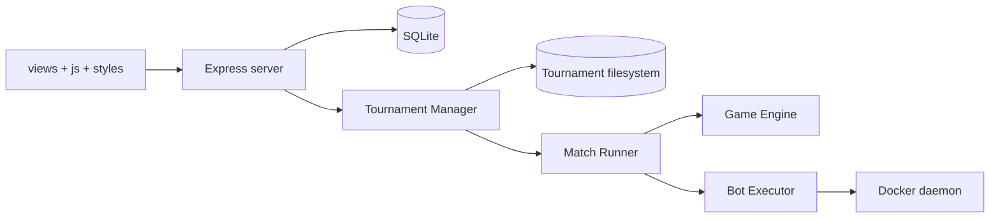

# Phát triển OTT Code Arena

## 1. Yêu cầu

- Node.js >= 20 (CI dùng 20.19.5).
- npm và dependency trong `package-lock.json`.
- Docker Desktop/Engine nếu chạy source revision, Docker integration tests hoặc Compose execution profile.
- Windows PowerShell/CMD cho `run-local.cmd` và `run-public.cmd`; các lệnh npm tương đương chạy được trên hệ điều hành khác.

## 2. Cài đặt và chạy

```powershell
npm.cmd ci
$env:NODE_ENV = 'development'
$env:EXECUTION_POLICY = 'development'
npm.cmd run dev
```

`predev` build HTML từ các partial. Server phát triển dùng `tsx watch server/index.ts`.

Chạy production build local:

```powershell
npm.cmd run build
$env:NODE_ENV = 'production'
npm.cmd start
```

`npm run build` lần lượt build HTML, bundle frontend, chạy TypeScript compiler và `tsc-alias`. Entry point sau build là `dist/server/index.js`.

## 3. Cấu trúc và data flow



- `engine/`: logic thuần của bàn cờ.
- `bot-protocol/`: schema request/response và validation.
- `bot-sdk/`: runner/template Strategy SDK.
- `bot-executor/`: Docker args, artifact cache, compile/runtime và limiter.
- `match-runner/`: turn loop, live snapshot, result/replay.
- `tournament/`: state machine, scheduling, series, persistence/recovery.
- `server/`: API, auth/session, repository SQLite và projection.
- `views/`, `js/`, `styles/`: SPA không dùng framework.

Chi tiết ở [Kiến trúc](architecture.md).

## 4. Biến môi trường tối thiểu

Sao chép giá trị phù hợp từ `.env.example`; server không tự đọc file `.env` bằng dependency dotenv, vì vậy shell/Compose/platform phải inject biến.

| Biến | Mặc định/code path | Ý nghĩa |
| --- | --- | --- |
| `PORT` | `3000` | Cổng Express |
| `NODE_ENV` | tùy shell | Điều khiển cookie/policy production |
| `EXECUTION_POLICY` | `development` trong ví dụ | `development` hoặc `sandbox-required` |
| `ENABLE_SOURCE_REVISION_EXECUTION` | `false` trong Compose cơ sở | Bật executor source revision |
| `TOURNAMENT_DATA_DIR` | dưới `data/` nếu không override | Dữ liệu tournament filesystem |
| `BOT_EXECUTION_WORKDIR` | runtime workspace | Workspace tạm/artifact |
| `BOT_*_IMAGE` | cần digest trong production | Image sandbox/runtime/compiler |

Danh sách vận hành đầy đủ ở [Triển khai](deployment.md) và [Bot Executor](bot-executor.md).

## 5. Lệnh build và test

| Lệnh | Tác dụng |
| --- | --- |
| `npm run build:html` | Ghép layout/page thành `index.html` |
| `npm run build:frontend` | Bundle JS/CSS thành asset root |
| `npm run build:public` | Tạo frontend tĩnh tại `dist/public` |
| `npm run build` | HTML + frontend + TypeScript production build |
| `npm run lint` | Script ESLint cho `.ts`; hiện dừng vì repository chưa có file cấu hình ESLint |
| `npm exec tsc -- --noEmit` | Typecheck không sinh file |
| `npm test` | Chạy toàn bộ Vitest theo config |
| `npm run engine:test` | Chỉ test `tests/engine` |
| `npm run test:coverage` | Coverage bằng V8 |
| `npm run dev:qa` | Build HTML rồi chạy QA server |

CI chạy typecheck, build ứng dụng, build public frontend, non-Docker tests với một số suite nặng bị loại khỏi job này, và kiểm tra Compose config. Docker security integration có workflow riêng. Không coi `npm run lint` là gate đang hoạt động cho đến khi repository có cấu hình ESLint.

## 6. Quy ước thay đổi

- Giữ Game Engine deterministic; thêm test cho mọi thay đổi luật.
- API ghi phải giữ `requireAuth`, đúng role, CSRF và ownership.
- Source revision phải tiếp tục ghim source/SDK identity.
- Result/replay phải đi qua commit coordinator; không ghi trực tiếp để bỏ qua hash.
- Frontend label/hành vi phải đối chiếu backend state, không suy từ phase hiển thị.
- Không dùng child-process executor cho mã không tin cậy.

## 7. Debug có kiểm soát

- API trả lỗi JSON dạng `{ "error": "..." }`; xem status trước khi đọc message.
- Kiểm tra `/api/system/queue` và `/api/system/metrics` bằng organizer.
- Với Docker, kiểm tra daemon, image digest, trusted registry, limiter và workspace permissions.
- Không dùng dữ liệu production để chạy test. Các test cần temp directory hoặc data dir cô lập.
- Không sửa file dưới `data/tournaments` bằng tay để “chữa” state; dùng API/recovery logic và giữ commit evidence.

Xem ma trận suite tại [Kiểm thử](testing.md).
