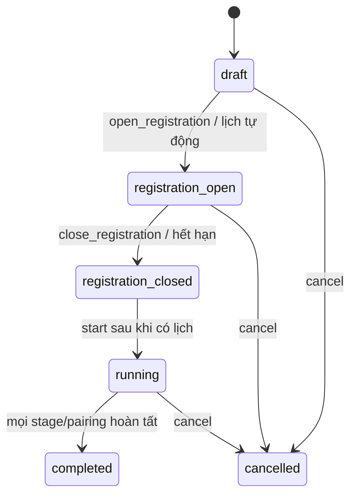

# Vòng đời giải đấu

## 1. Trạng thái chính



`resultsPublishedAt` là mốc công bố trên tournament `completed`, không phải status riêng. UI ánh xạ trạng thái sang bảy phase hiển thị:

1. Nháp/cấu hình.
2. Mở đăng ký.
3. Chốt danh sách.
4. Có lịch.
5. Đang chạy.
6. Hoàn tất, đang kiểm tra kết quả.
7. Đã công bố.

Phase là presentation; backend status và dữ liệu schedule/publication mới là nguồn quyết định.

## 2. Stage gate

Multi-stage lưu progress/current stage. Sau khi stage hiện tại hoàn tất, manager persist pending gate và không tự chạy stage kế tiếp. Organizer gọi action `start_next_stage`; scheduler kiểm tra owner, trạng thái, gate và execution đang hoạt động trước khi tạo task.

Việc **Dừng trận đấu** chỉ hủy task đang chạy. Kết quả đã commit được giữ; pairing chưa hoàn tất có thể chạy lại. **Hủy giải đấu** là transition khác sang `cancelled`.

## 3. Đăng ký và participant snapshot

Competitor gửi participation request với Bot/source revision đã chọn. Request có state `pending`, `approved` hoặc `rejected`; undo có thể đưa quyết định về trạng thái được phép bởi manager.

Preflight là gate bắt buộc trước approval/scheduling cho source Bot. Khi approval thành công, participant snapshot chứa execution identity đã ghim: competitor, Bot, revision, runtime, source digest, execution mode và SDK identity nếu có. Tournament không tự đổi theo revision hiện hành sau đó.

## 4. Lập lịch và format

- `single_round_robin`: tạo pairing cho mọi cặp participant.
- `multi_stage`: auto-format tạo regional/group/knockout theo số participant và cấu hình.
- Group stage dùng series BO2.
- Regional qualifier và knockout dùng BO3.
- Slot của vòng sau tham chiếu winner/rank của pairing/group trước; commit coordinator resolve participant khi nguồn đã hoàn tất.

Backend kiểm tra pending request, preflight, participant count và schedule tồn tại trước transition tương ứng.

## 5. Series và scoring

### BO2

- Hai ván với phía A/B hoán đổi.
- Mỗi ván tạo result/replay; series aggregate số ván thắng.
- Series có thể hòa.

### BO3

- Tối đa ba ván, dừng khi một participant đạt hai chiến thắng.
- Phía được xác định deterministic từ seed và game number.
- Nếu game 3 hòa, nhiều quân còn lại hơn thắng; nếu bằng quân, phía A của game 3 thua và B thắng.

Vì vậy, cặp BO3 mới luôn có người thắng sau ván 3. Trạng thái `pending_tiebreaker` và action `resolve_tiebreaker` vẫn được giữ để phục hồi hoặc xử lý dữ liệu cũ đã được ghi theo quy tắc trước đó.

### Điểm bảng

Scoring mặc định của giải mới là thắng 3, hòa 1, thua 0. Standings được tổng hợp từ committed match records. Khi publish, manager kiểm tra/khôi phục standings stale từ dữ liệu persisted hợp lệ thay vì tin mù quáng derived state cũ.

## 6. Concurrency

```text
API execution task
  -> FairMatchDispatcher (global và per-run quantum)
    -> series scheduler
      -> DockerExecutionLimiter
        -> container compile/runtime
```

Giá trị cấu hình thường gặp:

- scheduler mặc định bật với `OTT_SERIES_MATCH_CONCURRENCY=2`;
- flag `OTT_ENABLE_SERIES_CONCURRENCY_2` cho phép mức 2;
- Compose đặt `OTT_DOCKER_EXECUTION_CONCURRENCY=1` nếu không override.

Concurrency quan sát được có thể thấp hơn do host capacity, stage dependency, số pairing sẵn sàng hoặc Docker limiter.

## 7. Persistence và commit

Một match hoàn tất không chỉ dựa vào status trong memory. Commit coordinator ghi:

1. match result;
2. replay;
3. commit evidence/hash;
4. cập nhật pairing/tournament theo fencing/claim hợp lệ.

Identity `tournamentId`, `pairingId`, `matchId` và hashes phải khớp. Public replay exporter đọc committed set và từ chối dữ liệu thiếu/không nhất quán.

SQLite `tournament_match_jobs` lưu durable queue fields như status, attempt, lease owner/expiry, fencing token, next attempt và last error. Tournament JSON giữ state business và checkpoints.

## 8. Recovery và retry

Khi restart/recovery:

- job lease hết hạn có thể được reclaim theo durable store;
- pairing đã có committed result hợp lệ không chạy lại chỉ vì in-memory state mất;
- commit chưa đầy đủ/identity sai không được coi là hoàn tất;
- infrastructure error có thể retry/requeue;
- compilation/runtime/protocol/illegal move của Bot tạo forfeit theo match policy;
- retry dùng claim/fencing để ngăn worker cũ commit đè worker mới.

Không sửa tay file result/replay/commit. Nếu dữ liệu mâu thuẫn, giữ bản sao và điều tra bằng repository/manager validation.

## 9. Công bố

Publish yêu cầu giải `completed`, owner organizer và CSRF. Manager xác thực persisted results/replays/standings rồi đặt `resultsPublishedAt`. Sau đó public projection và replay được mở cho người dùng xác thực.

Xem [Hướng dẫn ban tổ chức](organizer-guide.md), [Tournament & Live internals](tournament-live.md) và [Mô hình dữ liệu](data-model.md).
